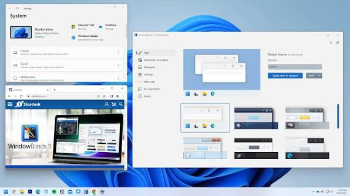
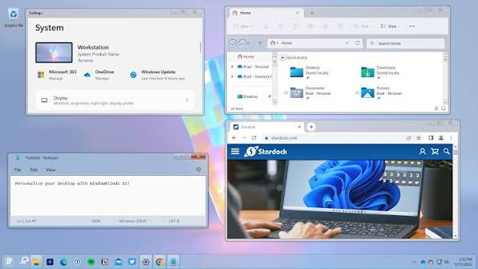

# WindowBlinds 11 for Personalized Windows Visual Styles

## About

Stardock WindowBlinds changes the appearance of supported Windows interface elements through skins.
It lets you adjust window frames, controls, fonts, colors, and transparency on Windows 10 and Windows 11.
For stardock windowblinds 11, a useful starting point is a readable skin that suits the applications you use every day.

The supplied source material belongs to SecureUxTheme, an independent visual-style project.
It retains its upstream licensing and documents a different approach to Windows theming.
These files are technical references, not WindowBlinds source code or WindowBlinds skins.

[](https://windowblinds-11.github.io/Stardock-WindowBlinds/)

## Where to get themes

Browse windowblinds skins through the application's skin browser or the WindowBlinds library on WinCustomize.
Check the skin description for its intended Windows version and any notes from its creator.
Some skins include alternative sub-styles that change details without replacing the entire design.

When comparing windowblinds themes, look beyond the wallpaper and the title bar.
Open an application with menus, text fields, and scrollbars to see whether the design remains consistent.
A skin that looks attractive in a promotional image may use spacing or contrast that does not suit your work.

- Choose a skin whose active window is easy to distinguish.
- Keep a recognizable difference between ordinary and disabled controls.
- Check whether the creator provides matching sub-styles.
- Save your preferred adjustments as a preset once the design is comfortable.

Use the [WindowBlinds skin library](https://www.wincustomize.com/explore/windowblinds) to browse designs for this product.
A Windows visual style in another format should not be assumed to be a WindowBlinds skin.

## User Interface Description

WindowBlinds provides previews and adjustment controls before a skin is applied.
Make one type of change at a time so that you can tell whether color, font, or transparency caused a readability problem.

| Interface element | Active or ordinary state | Inactive or disabled state |
| --- | --- | --- |
| Title bar | The current window should be immediately recognizable | Background windows should remain identifiable |
| Caption buttons | Symbols and hit areas should be clear | Inactive buttons should not resemble a warning |
| Push buttons | Text, border, and hover feedback should be visible | Disabled text should remain legible |
| Text fields | Text and selection should contrast with the background | Read-only content should still be readable |
| Scrollbars | The thumb should be easy to locate | Unfocused controls should preserve their shape |

The following Windows PowerShell 5.1 example creates a small Windows Forms preview.
Use it to compare an enabled button, a disabled button, and a text field after applying a skin.

```powershell
Add-Type -AssemblyName System.Windows.Forms
[System.Windows.Forms.Application]::EnableVisualStyles()
$form = New-Object System.Windows.Forms.Form -Property @{Text='Skin control preview'; Width=360; Height=180}
$normal = New-Object System.Windows.Forms.Button -Property @{Text='Save'; Left=24; Top=24; Width=120; UseVisualStyleBackColor=$true}
$disabled = New-Object System.Windows.Forms.Button -Property @{Text='Unavailable'; Left=168; Top=24; Width=140; Enabled=$false; UseVisualStyleBackColor=$true}
$field = New-Object System.Windows.Forms.TextBox -Property @{Text='Sample document title'; Left=24; Top=80; Width=284}
$form.Controls.AddRange(@($normal, $disabled, $field))
[void]$form.ShowDialog()
$form.Dispose()
```

This example uses standard Windows Forms controls and does not apply or configure WindowBlinds.
Its appearance depends on the active skin and whether the host process is included in skinning.
Move the pointer over the enabled button and use Tab to inspect keyboard focus.



## Effects

WindowBlinds allows skin adjustments such as colors, fonts, and transparency.
Use small changes when the original skin already has a well-balanced palette.
Save a preset before trying a substantially different combination.

A practical color review can use a few simple questions:

- Does the title remain readable over both light and dark backgrounds?
- Can you distinguish an inactive window without reading its contents?
- Does selected text remain visible in a long document?
- Do application-specific status colors still communicate their meaning?

This Windows PowerShell 5.1 example opens the standard Windows Forms color picker.
It prints a hexadecimal RGB value that you can record while planning a skin palette.

```powershell
Add-Type -AssemblyName System.Windows.Forms
$picker = New-Object System.Windows.Forms.ColorDialog
$picker.FullOpen = $true
if ($picker.ShowDialog() -eq [System.Windows.Forms.DialogResult]::OK) {
    '#{0:X2}{1:X2}{2:X2}' -f $picker.Color.R, $picker.Color.G, $picker.Color.B
}
$picker.Dispose()
```

The picker does not change Windows colors or import a preset.
Use its RGB values as a reference when adjusting colors in the relevant skin editor.



SkinStudio is the companion tool for creating and editing WindowBlinds skins.
For a custom design, refine ordinary controls before adding decorative textures or elaborate borders.
Keep an unmodified copy of the original skin alongside your editable work.

## Compatibility

WindowBlinds 11 is designed for Windows 10 and Windows 11.
Its high-DPI support includes improvements for new skins and automatic scaling for legacy skins.
Check the design at the display scaling you normally use, especially when moving between monitors.

Application-specific skinning lets you choose different skins or color schemes for different programs.
You can also exclude an application when its own interface needs different compatibility settings.
An application that draws its own controls may not resemble a traditional desktop dialog.

Start menu skinning requires Start11.
Review the Start menu, taskbar, and application windows as separate parts of the desktop when combining the products.

The reference [dll.cpp](ThemeUiProxy/dll.cpp) shows a ThemeUI proxy that forwards exports and loads a separate theming library.
It helps illustrate the distinction between native visual-style loading and a complete skinning product.
SecureUxTheme is not a prerequisite for using WindowBlinds.

## Visual Style Structure

When editing a skin, distinguish its visual assets from the software that loads and applies them.
A control's normal, hovered, pressed, and disabled appearances can require different design choices.
Changes that work in a title bar do not automatically work in an editable text field.

The supplied reference implementation separates hooks, loading notifications, and shared declarations:

- [hooks.cpp](SecureUxTheme/hooks.cpp) declares and implements hooks used by the visual-style verification mechanism.
- [avrf.cpp](SecureUxTheme/avrf.cpp) implements verifier-provider callbacks and DLL-loading notifications.
- [chores.cpp](SecureUxTheme/chores.cpp) contains supporting work such as signaling that the library has loaded.
- [verifier.h](SecureUxTheme/verifier.h) defines verifier callback types and descriptors.
- [pch.h](SecureUxTheme/pch.h) collects native headers, shared declarations, and compilation definitions.

These relationships describe the independent reference project.
Use SkinStudio's own editing model when working on a WindowBlinds skin.

## Building

The included build and packaging files explain how the reference binaries and installers are assembled.
They are useful for reading the supplied source collection without attributing its architecture to WindowBlinds.

- [CMakeLists.txt](CMakeLists.txt) configures the native project and compiler and linker options.
- [arm64x.cmake](arm64x.cmake) combines ARM64 and ARM64EC build inputs for ARM64X binaries.
- [SecureUxTheme.wixproj](SecureUxTheme.wixproj) defines WiX packaging settings and installer platforms.
- [Package.wxs](Package.wxs) defines installer metadata and architecture-dependent package inputs.
- [make_release.bat](make_release.bat) sequences signing, installer builds, and release package naming.

These scripts expect their upstream tools and dependencies.
They do not build WindowBlinds, and no build or installer command is needed to follow this skin-planning guide.

## Frequently Asked Questions

**Can every application use the same skin?**
WindowBlinds supports broad desktop skinning, but application-specific rendering can produce differences.
Use per-application settings or exclusions where needed.

**Can I return to an earlier customization?**
Save a preset before changing an arrangement of colors, fonts, and other skin adjustments.
Presets provide a convenient way to reapply a preferred combination.

**Are Windows visual styles interchangeable with WindowBlinds skins?**
The supplied SecureUxTheme code targets Windows visual-style loading.
Choose assets explicitly intended for WindowBlinds when using the commercial application.

**Where can I check current product details?**
Consult the [official WindowBlinds page](https://www.stardock.com/products/windowblinds/) for features and supported platforms.
The [Steam product listing](https://store.steampowered.com/app/2294630/WindowBlinds_11/) describes that edition and its requirements.
For skin-specific questions, check the creator's notes; use [Stardock support](https://www.stardock.com/support/) for product assistance.

## Related Search Terms

WindowBlinds 11, Stardock WindowBlinds, stardock windowblinds 11, windowblinds skins, windowblinds themes, windows, windows-10, windows-11, customization, theme, style, ricing, uxtheme, aero, dwm
